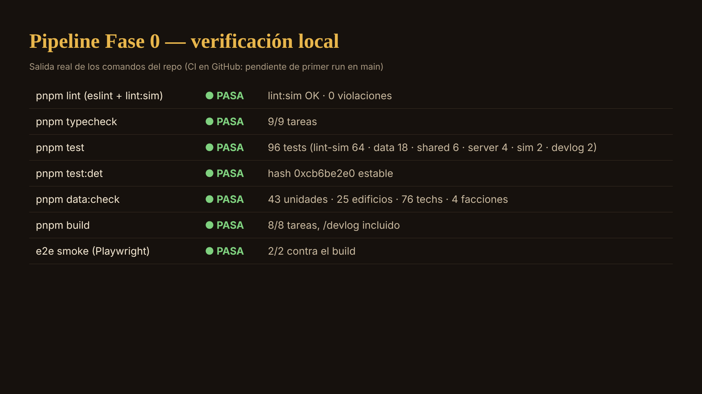
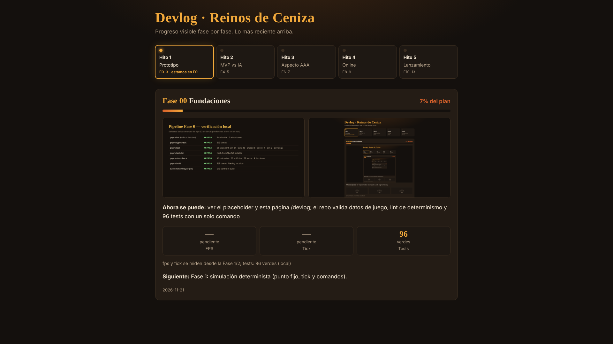

# Fase 00 — Fundaciones (7% del plan)

 

**Ahora se puede:** ver el placeholder y esta página /devlog; el repo valida datos de juego, lint de determinismo y 96 tests con un solo comando

**Métricas:** fps: pendiente · tick: pendiente · 96 tests verdes (fps y tick se miden desde la Fase 1/2; tests: 96 verdes (local)).

**Siguiente:** Fase 1: simulación determinista (punto fijo, tick y comandos).
