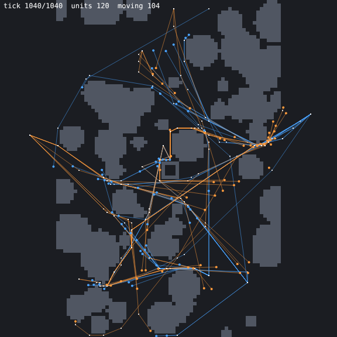
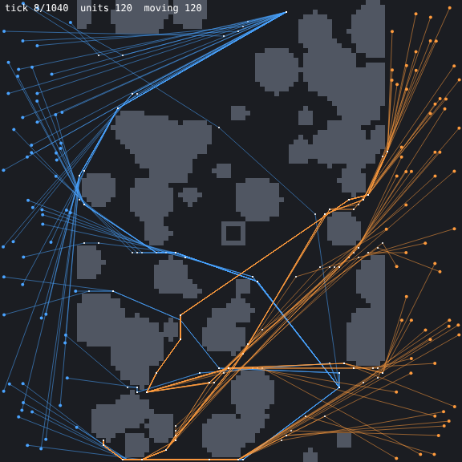

# Fase 01 — Núcleo de simulación determinista (14% del plan)

  [video](media/f1-debug.webm)

**Ahora se puede:** correr una simulación headless reproducible bit a bit: 1000 unidades × 10 000 ticks con pathfinding jerárquico y steering, el mismo hash en Node y Chromium (hilo principal y Worker)

**Métricas:** fps: pendiente · tick 0,7 ms · 344 tests verdes (tick medio 0,71 ms (p95 1,72 ms) con 400 unidades, objetivo ≤ 3 ms; 1000 unidades: media 1,70 ms. Firefox/WebKit pendientes de CI.).

**Siguiente:** Fase 2: render isométrico base con PixiJS (simulación en Web Worker, cámara, niebla, selección).
