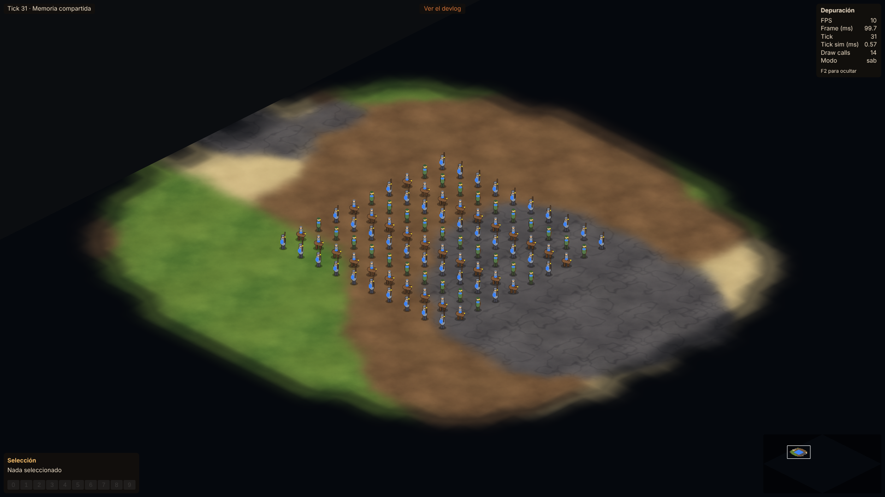
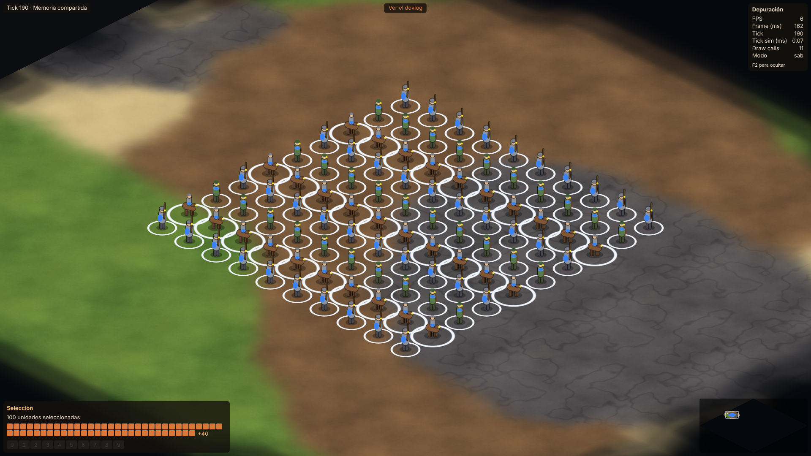
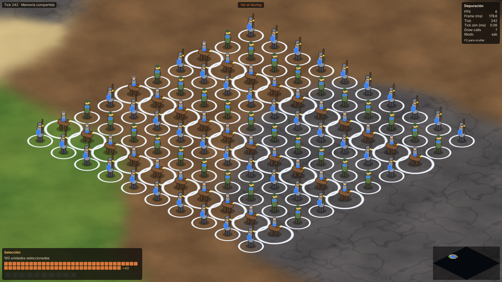
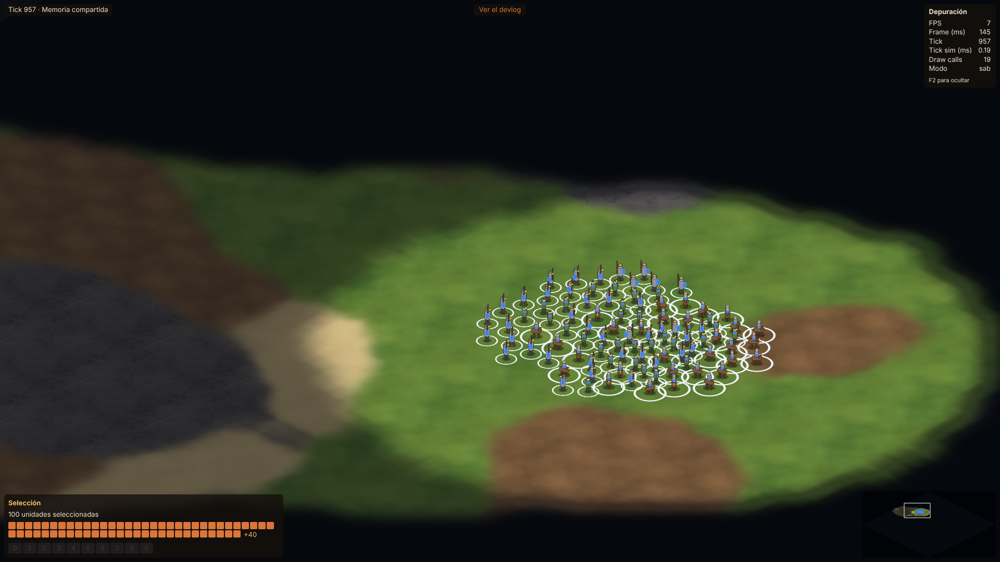
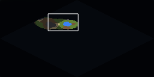
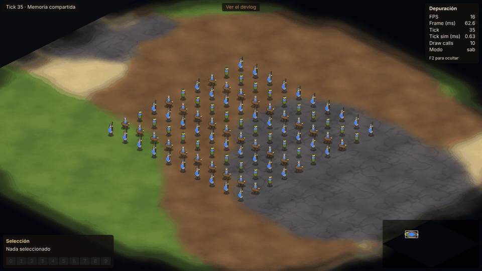

# Fase 02 — Render isométrico base (21% del plan)

      [video](media/select-move-100.webm)

**Ahora se puede:** ver y controlar la simulación en el navegador: mapa isométrico con PixiJS (terreno por chunks sin costuras, tres niveles de zoom), unidades interpoladas sobre una simulación a 20 Hz en un Web Worker, niebla de guerra con tres estados, minimapa, selección con caja de 100 unidades y órdenes de movimiento con clic derecho (arte provisional procedural)

**Métricas:** fps: pendiente · tick 0,43 ms · 616 tests verdes (fps sin medir en hardware de referencia (K1: TODO-HUMANO); en SwiftShader, solo informativo, 12/8,7/7 fps a zoom 0,6/1/1,4 con 400 unidades. Tick = media del Worker con 400 unidades (p95 0,5-0,6 ms, gate 3). Proxy completo (updateMs p95 1,3-2,0 ms, draw calls p95 7-15, ticksDropped 0) en media/perf.md. 616 tests de pnpm test, más 26 e2e de render).

**Notas:**

- Grupos de control: Ctrl+0–9 guarda el grupo y 0–9 lo recupera (doble pulsación centra la cámara). Como los navegadores reservan Ctrl+1–8 para cambiar de pestaña y no dejan cancelar el evento, también funciona Alt+dígito (y Meta+dígito en macOS) para guardar; la tabla está en packages/client/src/input/keymap.ts.
- K1 (400 unidades a >= 60 fps) NO se da por cumplido: el proxy de software no es el hardware de referencia. Pendiente TODO-HUMANO: abrir /?perf=400&debug=1 en el portátil de referencia, 60 s, ejecutar __reinos.perfReport() y adjuntar el JSON (aceptación: fpsP5 >= 60).
- Capturas y vídeo con el escenario demo200 (100 unidades propias por jugador), 1920x1080 las imágenes y 1280x720 el clip, regenerables con pnpm media:render. El arte (terreno, unidades, anillos) es provisional y procedural: terreno borroso y sin lagos ni bosques dibujados, sprites simples con solapes; se sustituye en Fase 6.
- Proxy de rendimiento: pnpm perf:render (informe en media/perf.md y perf.json).

**Siguiente:** Fase 3: economía y construcción (recursos, edificios, aldeanos) sobre el render y el worker de esta fase.
